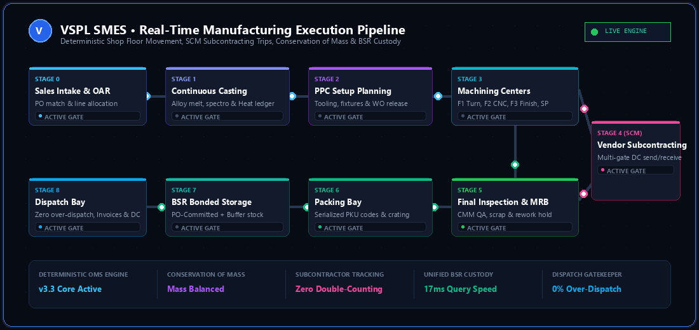
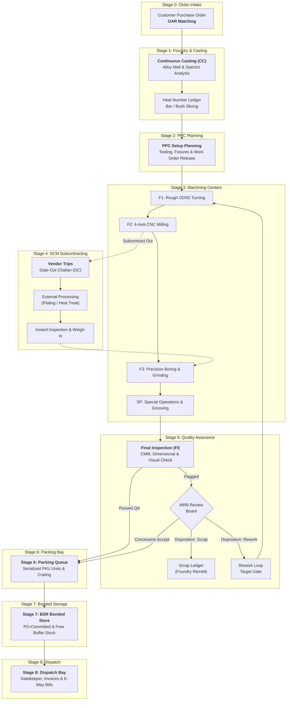

# VSPL Smart Manufacturing Execution System (SMES) & OMS

<div align="center">



<br/>

[](https://oms.vijayspheroidals.in)
[](https://cloud.google.com/run)
[](https://cloud.google.com/sql)
[](https://nextjs.org/)
[](https://fastapi.tiangolo.com/)
[-brightgreen?style=for-the-badge&logo=pytest&logoColor=white)]()

<p align="center">
  <b>The Mission-Critical Operating System for Precision Centrifugal Bronze Casting & CNC Machining</b><br/>
  <i>Engineered for Vijay Spheroidals Pvt Ltd (Plant 1: Foundry & Precision Machining Division)</i>
</p>

</div>

---

## 🏭 Executive Summary

The **VSPL Smart Manufacturing Execution System (SMES)** is an enterprise-grade, deterministic manufacturing execution and order management platform. Built to replace paper travellers and fragmented spreadsheets, it enforces physical reality on the shop floor across every transition from raw alloy casting to precision CNC machining, multi-gate vendor subcontracting, bonded storage, and automated dispatch gatekeeping.

At its core, the platform operates on an authoritative **Deterministic State Machine (OMS Engine)** backed by a **Pure Mathematical KPI Engine** and a **Conservation of Mass Reconciliation Ledger**:

$$\text{Released Heat Mass} = \text{Active WIP} + \text{BSR Bonded Stock} + \text{Dispatched Goods} + \text{Validated Scrap}$$

---

## 🔄 End-to-End Manufacturing Workflow



---

## 🧩 Architectural Pillars & Core Modules

### 1. Continuous Casting (CC) & Heat Ledger (`/cc`)
- **Foundry Ingestion**: Real-time logging of crucible melts, alloy chemistry (PB2, PB4, Lead Bronze, Aluminum Bronze), and chemical spectrometry logs.
- **Continuous Casting Traceability**: Raw hollow billets and solid bars are assigned indelible Heat Numbers (`HT-XXXXXX`) maintaining lineage into cut work order billets.
- **Conversion Calculations**: Automatic density and dimension calculators computing theoretical vs. physical casting recovery yields.

### 2. PPC Setup Planning & Machine Scheduling (`/planning`)
- **Capacity & Machine Allocation**: Visual gantt-style matrix for CNC turning centers, VMCs, and manual lathes.
- **Setup Sheet Verifications**: Operators cannot clock into a stage without verification of programmed tool offsets, jigs, and fixtures.
- **Dynamic Lot Split & Release**: High-volume purchase orders are intelligently partitioned into operational batch sizes balancing WIP congestion against machine changeover times.

### 3. Machining Work Centers (F1 ➔ F2 ➔ F3 ➔ SP) (`/move`)
- **Stage Isolation**: Complete separation of operational status (`Pending`, `In-Process`, `Completed`, `Rejected`).
- **One-Tap Barcode / QR Scanning**: Shop-floor operators log part movements directly via rugged tablets or optical barcode scanners.
- **Scrap Segregation**: Distinguishes between **Casting Defects** (blowholes, porosity, inclusions) credited back to the foundry vs. **Machining Rejections** (tool chatter, dimensional undersize).

### 4. SCM Multi-Gate Subcontractor Tracking (`/vendor-tracking`)
- **Zero Double-Counting**: Outward vendor movements isolate parts in a dedicated external holding state without corrupting active shop-floor WIP.
- **Trip & Gate-Out Manifest**: Generates Delivery Challans (DC) with registered GSTINs, transporter vehicle logs, and turnaround ETAs.
- **Inward Re-conciliation**: Verification of received quantities against dispatched quantities with scrap/rejection liability attribution.

### 5. Final Inspection & Material Review Board (MRB) (`/mrb`)
- **Non-Conformance Hold (NC Hold)**: Parts deviating from engineering drawings are locked out of packing queues and transferred to the MRB quarantine pool.
- **Multi-Role Disposition**: QA Head and Production Manager jointly review quarantined lots with 4 clear dispositions:
  1. *Rework at Preceding Stage*
  2. *Accept on Concession (Customer Deviation Request)*
  3. *Downgrade to Buffer Stock*
  4. *Reject to Foundry Scrap (Re-melt)*

### 6. Packing Bay & Serialized PKU Generator (`/packing`)
- **Serialized Packing Units**: Generates unique `PKU-XXXXXX` barcodes per carton, pallet, or wooden crate.
- **Customer Packaging Compliance**: Automatically pulls customer-specific preservation, VCI wrapping, and labeling requirements.
- **Instant Staging**: Submitting packed goods moves stock directly into Stage 7 (BSR Bonded Storage) with real-time operator feedback.

### 7. Unified BSR (Bonded Storage Room) (`/bsr`)
- **Dual Stock Architecture**:
  - **PO-Committed Stock**: Finished goods tied to open Customer Purchase Orders ready for dispatch call-off.
  - **Free Excess Buffer Stock**: Surplus yields and planned safety buffer available for dynamic allocation to incoming OARs.
- **Sub-20ms Optimized Inventory**: High-performance indexed relational querying returning full warehouse inventory in 17ms across 6,000+ catalog parts.

### 8. Dispatch Bay & Over-Dispatch Gatekeeper (`/dispatch`)
- **Strict Anti-Overdispatch Gate**: Mathematical validation guaranteeing dispatched units never exceed the original customer PO quantity.
- **Commercial Documentation**: Automated generation of Delivery Challans, Commercial Packing Lists, and invoice pre-clearance.

---

## 👥 Role-Based Access Control (RBAC)

The system enforces strict operational segregation of duties across 10 distinct plant profiles:

| Role Code | Role Name | Primary Responsibilities | Core Dashboards & Permissions |
|:---|:---|:---|:---|
| `admin` | **System Administrator** | User administration, audit logs, global configuration | Full unrestricted access |
| `ceo` | **Executive Leadership** | Plant throughput, revenue KPIs, executive overview | Executive Insights, Financial Reports |
| `pm` | **Production Manager** | Daily output quotas, line balancing, bottlenecks | Live WIP Matrix, MRB Dispositions, CC |
| `planner` | **PPC Lead Planner** | Work Order release, machine scheduling, setup planning | Setup Planning, Machine Allocation |
| `scm` | **Supply Chain Manager** | Subcontracting trips, vendor DC inward/outward | Vendor Tracking, Transporter Logistics |
| `qa` | **Quality Assurance Lead** | Final inspection (FI), spectrometer logs, calibration | Stage 5 FI, MRB Review Board, CAPA |
| `operator` | **Shop Floor Operator** | Cycle times, stage handoffs, QR scanning | Stage Movement (`/move`), Machining Gates |
| `accounts` | **Finance & Billing** | Invoicing, rate cards, inventory valuation | Dispatch Invoices, Scrap Reconciliations |
| `engineering`| **Process & Tooling** | Part masters, route definitions, setup sheets | Part Catalog, CAD Drawing Links |
| `sales` | **Commercial & Order Desk**| PO registration, OAR matching, customer liaison | OAR Register, Customer Portal |

---

## ⚙️ Production Cloud Architecture

```
                                 [ Production Internet ]
                                            │
                                            ▼
                           ┌─────────────────────────────────┐
                           │   Cloudflare DNS / SSL Proxy    │
                           │     oms.vijayspheroidals.in     │
                           └─────────────────────────────────┘
                                            │
                                            ▼
                     ┌─────────────────────────────────────────────┐
                     │          Google Cloud Run (vspl-oms)        │
                     │       Serverless Auto-scaling Container     │
                     │                                             │
                     │  ┌───────────────────┐  ┌────────────────┐  │
                     │  │   Next.js 15 UI   │  │ FastAPI Engine │  │
                     │  │  React 18 / SSR   │  │   Python 3.11  │  │
                     │  │  (Port 3000 / UI) │  │  (Port 8000)   │  │
                     │  └─────────┬─────────┘  └───────▲────────┘  │
                     │            │ Reverse Proxy      │           │
                     │            └────────────────────┘           │
                     └──────────────────────┬──────────────────────┘
                                            │ Cloud SQL Auth Proxy
                                            ▼
                           ┌─────────────────────────────────┐
                           │      Google Cloud SQL (vspl)    │
                           │          PostgreSQL 16          │
                           │   SSD Storage & Daily Backups   │
                           └─────────────────────────────────┘
```

---

## 🚀 Local Development & Quickstart

### Prerequisites
- **Node.js**: v18.17+ or v20.x
- **Python**: v3.10+ (Recommended: 3.11 or 3.12)
- **Git**

### 1. Clone & Configure
```bash
git clone https://github.com/DarshanCat/VSPL-OMS.git
cd VSPL-OMS
```

### 2. Backend Setup
```bash
cd backend
python -m venv venv

# Windows (PowerShell):
.\venv\Scripts\Activate.ps1
# Linux / macOS:
source venv/bin/activate

pip install -r requirements.txt

# Start FastAPI API Server on localhost:8000
uvicorn app.main:app --host 127.0.0.1 --port 8000 --reload
```

### 3. Frontend Setup
```bash
cd ../frontend
npm install

# Start Next.js Development Server on localhost:3000
npm run dev
```

Visit **[http://localhost:3000](http://localhost:3000)** in your browser.

---

## 🧪 Automated Testing Suite

The repository maintains strict verification coverage across both business logic and user interface layers:

```bash
# Execute Backend Pytest Suite
cd backend
python -m pytest tests/ -v
```

```bash
# Execute End-to-End Handover Verification
python scripts/test_packing_bsr_e2e.py
```

```bash
# Execute Frontend Production Build Check
cd frontend
npm run build
```

---

## 🚢 Production Deployment

Automated one-command containerization and deployment to Google Cloud Run:

```powershell
# Deploy from root via Google Cloud Build & Cloud Run
.\deploy.ps1
```

*Build Image Registry:* `asia-south1-docker.pkg.dev/vspl-oms-510015/vspl-oms/vspl-oms`  
*Production Region:* `asia-south1 (Mumbai, India)`

---

<div align="center">
  <sub>© 2026 Vijay Spheroidals Pvt Ltd (VSPL). All Rights Reserved. Proprietary & Confidential.</sub>
</div>
